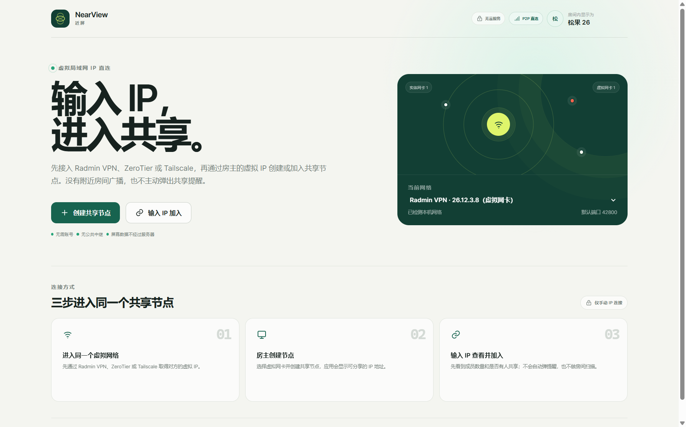
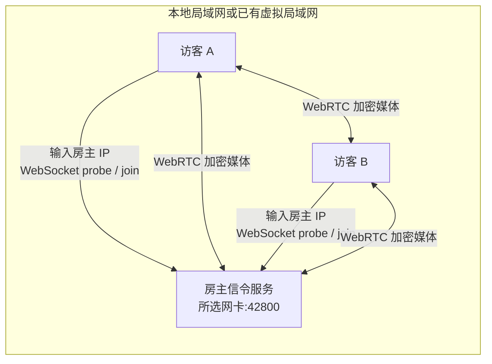

<p align="center">
  
</p>

<h1 align="center">NearView</h1>

<p align="center">
  面向虚拟局域网的轻量多人屏幕共享工具。
</p>

<p align="center">
  
  
  
  
</p>

<p align="center">
  
</p>

<p align="center">
  <sub>界面预览使用演示网卡与演示 IP，不包含真实局域网信息。</sub>
</p>

> NearView 不提供账号、公共目录或中继服务。先从 Radmin VPN、ZeroTier、Tailscale 等客户端取得虚拟 IP，再通过 IP 建立点对点屏幕共享。

[功能](#功能) · [快速开始](#快速开始) · [使用方式](#使用方式) · [工作原理](#工作原理) · [常见问题](#常见问题) · [安全边界](#安全边界) · [参与开发](#参与开发)

## 为什么选择 NearView

- **不用部署服务器**：房主进程内置信令服务，屏幕流直接在设备之间传输。
- **不做房间扫描**：没有 UDP 组播和附近发现，只有知道房主 IP 的人才能探测并加入。
- **两种网络模式**：建立房间时选择本地实体网卡，或选择 Radmin VPN 等已有虚拟网卡。
- **多人同时共享**：房间内最多按 8 人 P2P Mesh 设计，可以同时观看多路屏幕。
- **自动最低同步延迟**：房主汇总所有成员 RTT，动态计算 50–240ms 的统一目标；网络越快，延迟越低。
- **隐私暂停**：暂停实时画面和音频，只向观看者发送冻结帧。
- **原生屏幕标注**：观看者标注会同步显示在其他观看画面，也覆盖到共享者的电脑屏幕。
- **个人资料与本地设置**：昵称、状态、头像颜色、默认画质和关闭行为保存在本地。
- **屏幕信息浮层**：全屏观看时可叠加聊天和在线成员。

## 功能

### 房间与网络

- 本地局域网模式：选择 Ethernet、Wi-Fi 等实体网卡。
- 虚拟局域网模式：识别 Radmin VPN、ZeroTier、Tailscale、WireGuard、TUN/TAP 等虚拟网卡。
- 默认信令端口 `42800`，端口冲突时自动选择其他可用端口。
- 虚拟局域网模式优先选择 Radmin VPN 等 VPN 网卡，而不是 WSL/Hyper-V 虚拟交换机。
- 房主通过本机回环连接内置信令服务，外部成员则通过所选虚拟 IP 连接。
- 输入 IP 后查看房间名称、成员数量、密码状态和正在共享的画面数量。

### 屏幕共享

- 整个显示器或单个应用窗口。
- 可选不共享声音、共享系统声音，或在窗口共享时仅捕获该程序及子进程的声音。
- 多人同时共享、宫格预览、单人聚焦、全屏和原生画中画。
- 三档画质：
  - 文字优先：1080p，清晰度优先；
  - 均衡：1600×900；
  - 流畅：720p/60fps。
- 自适应降级：根据 P2P RTT、丢包、抖动和 CPU 编码压力单独调整码率、分辨率和帧率。
- 暂停共享时冻结当前帧并停止发送实时音频。

### 协作

- 带观看者昵称的点击光圈和拖拽箭头。
- 标注自动消失，不夺取共享者的鼠标控制权。
- 标注同步显示在所有观看端，并通过内容保护透明窗口显示在共享者桌面。
- 标注坐标按真实视频内容区计算，兼容不同窗口比例与黑边；昵称自动避让边缘并短暂淡出。
- 房间聊天和剪贴板文本投递。
- 单条消息快速复制。
- 有人加入正在共享的房间时，仅共享者收到应用内提示。
- 可开关的聊天与在线成员屏幕覆盖层。

### 个人资料与设置

- 昵称、个人状态和头像颜色保存在本地，并同步显示给房间成员。
- 可设置默认画质。
- 可选择关闭按钮的行为：每次询问、最小化到托盘或直接退出。
- 关闭提示附带“不再提示”选框，选择后仍可在设置中修改。

### 状态与诊断

- 每两秒通过 WebRTC DataChannel 测量端到端 P2P PING。
- 成员列表显示四格信号强度。
- 显示每位成员的连接和共享状态。
- 房间页显示当前网络方式和实际使用的网卡名称。
- 内置双实例端到端冒烟测试，可验证真实屏幕捕获与视频收流。

## 快速开始

### 直接运行 Windows 版本

从 GitHub Releases 下载：

- `NearView-x.y.z-win-x64.zip`：解压后运行 `NearView.exe`。
- `NearView Setup x.y.z.exe`：安装版（网络可用时由本地构建生成）。

Windows 首次运行时，请允许应用访问“专用网络”。默认需要放行 TCP `42800`；如果界面显示了其他端口，以实际端口为准。

### 从源码运行

要求：

- Node.js 22+
- pnpm 10+
- Windows 10/11（当前主要验证平台）

```bash
git clone <your-repository-url>
cd nearview
pnpm install
pnpm dev
```

生产构建：

```bash
pnpm build
pnpm package
```

构建输出：

- Web、主进程和预加载脚本：`out/`
- Windows 免安装目录：`release/win-unpacked/`
- 安装包与其他发布产物：`release/`

## 使用方式

### 1. 准备网络

如果双方不在同一本地网络，请先使用 Radmin VPN、ZeroTier 或 Tailscale 建立虚拟局域网，并确认双方能够互相访问虚拟 IP。

NearView 不创建 TUN/TAP 虚拟网卡，也不提供公网中继。

### 2. 房主创建房间

1. 点击“创建共享节点”。
2. 选择网络方式：
   - **本地局域网**：选择实体网卡；
   - **虚拟局域网**：选择已经启动的 Radmin VPN 等虚拟网卡。
3. 设置可选密码并进入房间。
4. 将房间右上角显示的 IP 和实际端口发给好友。

### 3. 访客加入

1. 点击“输入 IP 加入”。
2. 输入房主 IP。默认端口为 `42800`；如果房主使用其他端口，请输入完整地址。
3. 应用会显示房间人数和当前共享数量。
4. 输入密码并加入。

### 4. 开始共享

点击“共享我的屏幕”，选择整个显示器或某个应用窗口。

## 工作原理



房主只处理房间探测、WebSocket 信令、SDP、ICE 和房间文字，不转发屏幕画面。

屏幕与系统声音通过 WebRTC DTLS-SRTP 加密，直接在设备之间传输。NearView 不依赖 STUN/TURN，也不做公网穿透，因此双方必须在网络层可达。

## 延迟一致性

Mesh 中不同观看者的网络延迟可能不同。所有客户端每两秒测量真实 P2P RTT，房主信令节点汇总后广播统一目标：

```text
统一目标 = clamp(房间最大 RTT / 2 + 45ms, 50ms, 240ms)
音视频播放缓冲 = clamp(统一目标 - 本机 RTT / 2, 30ms, 260ms)
```

- 局域网或低延迟虚拟局域网通常收敛到约 50ms。
- 网络更快的一端使用更大的本地缓冲，尽量与较慢成员看到同一时间点。
- 视频与音频接收器设置相同播放缓冲，避免特效场景下声音跑在画面之前。
- RTT 超过 250ms 时，该路连接自动降低码率和分辨率。
- RTT 超过 450ms 时进一步减少码率与帧率。
- 丢包超过 3%、抖动超过 80ms 或编码器出现 CPU 压力时提前降级。
- 仍然追不上同步目标时，WebRTC 会丢帧追赶。

这是“统一目标缓冲 + 每连接自适应”，不是基于主时钟的帧级严格同步。高丢包、Wi-Fi 抖动和极端跨地域网络仍可能产生偏差。

### 高特效画面建议

- 游戏、粒子效果或高动态视频建议使用“流畅优先”模式，让编码器优先保持帧率。
- 有线网络优先；Wi-Fi 尽量使用 5GHz/6GHz 和 Wi-Fi 6，避免 2.4GHz 拥塞。
- 发送端 CPU 或 GPU 编码满载时会触发自动降分辨率，必要时关闭其他占用硬件编码器的程序。
- 单个程序音频捕获要求 Windows 10 2004 及以上，并使用“单个窗口”共享模式。

## 支持范围

| 项目 | 状态 |
|---|---|
| Windows 10/11 | 已完成实机与打包验证 |
| macOS | Electron 构建配置已提供，屏幕录制授权仍需实测 |
| Linux | Electron 构建配置已提供，桌面捕获仍需实测 |
| Radmin VPN 网卡 | 已支持识别和房间绑定；当前开发机网卡处于 Disabled，尚未做真实双机隧道联调 |
| ZeroTier / Tailscale / WireGuard | 按虚拟网卡名称自动识别，需要用户先启动对应客户端 |
| 公共房间目录 | 不支持 |
| 公共中继 / TURN | 不支持 |
| 内置虚拟局域网创建 | 不支持 |
| 远程控制 | 不支持 |

## 安全与隐私

- 屏幕和共享系统声音使用 WebRTC DTLS-SRTP。
- 房间密码以盐化 `scrypt` 摘要保存在房主内存中。
- 信令监听只绑定创建时选择的网卡地址。
- Electron 启用 `contextIsolation`、禁用 `nodeIntegration`，渲染进程只暴露白名单 IPC。
- 房间文字由房主中转，房主技术上可以读取，因此**不是端到端消息**。
- 信令使用明文 `ws://`，房间密码会发送给房主一次。
- 节点探测会向知道 IP 的客户端返回房间名称、人数、密码状态和共享数量。
- 当前没有证书指纹校验，不能抵御主动中间人攻击。
- 不要在公共 Wi-Fi 或公网端口上直接暴露 NearView。

详细威胁模型：[SECURITY.md](SECURITY.md)

## 语音、文字与滥用边界

NearView 当前**不提供麦克风语音聊天**。共享中的系统声音只是屏幕媒体的一部分。

文字聊天限定在私有房间内，并由房主进程中转。应用不把文字作为端到端安全通信产品宣传，也不提供公开聊天室、账号体系、公共目录或长期聊天记录。

公开分发或运营任何公共节点前，应配置接受使用条款、举报渠道和内容处置流程。详细边界见 [ACCEPTABLE_USE.md](ACCEPTABLE_USE.md)。

## 已知限制

- 必须依赖已有且互通的局域网或虚拟局域网。
- 没有公共会合服务、TURN 中继或公网穿透。
- 当前没有内置创建 WireGuard/TUN 虚拟网卡的能力。
- 多人 Mesh 需要共享者向每位观看者分别上传，8 人以上建议升级为 SFU。
- 当前按码率和分辨率约束做每连接自适应，尚未实现真正的 Simulcast 三层码流。
- 安装包签名、自动更新和崩溃上报尚未完成。

## 常见问题

### NearView 会创建 Radmin VPN 那样的虚拟网卡吗？

不会。当前版本检测并使用已经存在的虚拟网卡。用户需要先通过 Radmin VPN、ZeroTier、Tailscale 等客户端加入同一个虚拟网络，再在 NearView 创建房间时选择该网卡。

### 没有云服务器可以跨公网使用吗？

可以，前提是设备已经通过第三方虚拟局域网实现 IP 互通。NearView 不需要自建服务器，也不提供公共中继；如果双方网络层不可达，就无法建立连接。

### 屏幕数据会经过房主的 WebSocket 服务吗？

不会。房主的 WebSocket 服务只交换房间状态、SDP、ICE 和文字消息。屏幕与共享系统声音通过 WebRTC 在设备之间直接传输。

### 为什么输入 IP 后看不到房间？

依次检查：

1. 双方是否处于同一个 Radmin VPN、ZeroTier 或 Tailscale 网络；
2. 房主选择的网卡地址是否就是双方都能访问的虚拟 IP；
3. Windows 防火墙是否允许 TCP `42800`，或房间界面显示的其他端口；
4. 房主是否已经创建房间并且选择“虚拟局域网”模式。

### 虚拟局域网模式创建房间失败怎么办？

- 确认在“虚拟网卡”下拉框中明确选择了 `Radmin VPN`，而不是带有 `vEthernet`、`WSL`、`Hyper-V` 字样的系统虚拟交换机。
- Radmin VPN 网卡通常属于 Windows 的 Public 网络配置；首次运行时需要允许 NearView 在专用网络和公用网络上接收 TCP 连接。
- NearView 0.4.2 起会优先选择 Radmin VPN，并使用本机回环地址完成房主内部连接，避免直接回连虚拟 IP 导致失败。

### 文字聊天是端到端加密吗？

不是。文字由房主进程接收并广播，房主技术上可以读取。NearView 不提供麦克风语音聊天，也不承担公共聊天平台的角色。

## 开发与测试

```bash
pnpm typecheck
pnpm test
pnpm build
```

Windows 双实例端到端测试：

```bash
pnpm test:e2e
```

测试会自动完成：

- 创建本地局域网房间；
- 验证虚拟局域网模式与网卡提示；
- 仅输入 IP 探测共享节点；
- 加入后验证共享者提示和成员 PING；
- 捕获真实屏幕并通过 WebRTC 收流；
- 验证两端收到同一个自适应同步目标，低延迟网络收敛至约 50ms；
- 验证观看者标注出现在共享者的原生透明覆盖窗口；
- 验证个人资料设置与聊天/成员屏幕覆盖；
- 验证文字聊天、隐私暂停和恢复。

测试截图仅在本地生成，已被 `.gitignore` 排除。

重新生成 README 用的安全首页截图：

```bash
pnpm docs:screenshot
```

## 项目结构

```text
src/
├─ main/                 Electron 主进程、信令服务、网卡检测、屏幕捕获
├─ preload/              白名单 IPC 桥接
├─ renderer/             React 界面、WebRTC Mesh、延迟同步
└─ shared/               共享类型与地址解析

scripts/e2e-smoke.mjs    双实例端到端测试
tests/                   信令与网络地址单元测试
resources/               应用图标
docs/screenshots/        README 安全演示截图
```

## 参与贡献

欢迎提交 Issue 和 Pull Request。开始前请阅读 [CONTRIBUTING.md](CONTRIBUTING.md)。

提交媒体或网络相关修改时，请在 PR 中说明：

- 测试的操作系统和网络类型；
- 是否使用 Radmin VPN、ZeroTier、Tailscale 等虚拟网卡；
- 是否验证多端同时共享；
- 是否验证直连失败和端口占用场景；
- 是否影响隐私边界或房间权限。


## License

[MIT](LICENSE)

---

NearView is an open-source, IP-addressed screen sharing desktop app for trusted LAN and virtual-LAN environments. It prioritizes direct peer-to-peer WebRTC media, does not provide public discovery or relay infrastructure, and currently focuses on Windows.
